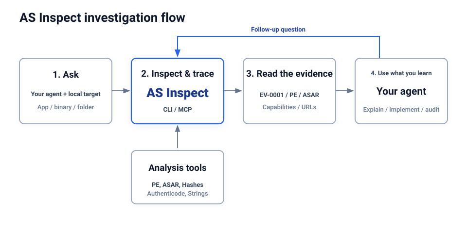

# AS Inspect

<p align="center">
  <strong>Understand applications with evidence.</strong>
</p>

<p align="center">
  <a href="https://github.com/abusafyan-official/AS-Inspect/actions"></a>
  <a href="https://github.com/abusafyan-official/AS-Inspect/releases"></a>
  <a href="LICENSE"></a>
  <a href="#"></a>
  <a href="#"></a>
</p>

<p align="center">
  <em>Evidence-based Windows application & binary reverse engineering toolkit for AI coding agents and security researchers.</em><br>
  <strong>Developed by Abu Safyan</strong>
</p>

---

## Quick Start

### Set Up Your Agent (MCP Integration)

AS Inspect connects AI coding agents (Claude Code, Cursor, Gemini CLI, Grok, and Antigravity) to native Windows analysis tools over Model Context Protocol (MCP):

```powershell
git clone https://github.com/abusafyan-official/AS-Inspect.git
cd AS-Inspect
```

Register the MCP server in your agent configuration (`claude_desktop_config.json`, `cursor`, or `antigravity`):

```json
{
  "mcpServers": {
    "as-inspect": {
      "command": "python",
      "args": ["-m", "crates/as-inspect-mcp/src/main.rs"]
    }
  }
}
```

Restart your agent afterward.

---

### Ask Your Agent

> *"Inspect how network requests and file operations work in `app.exe`, cite the evidence, and explain the security capabilities."*

Replace `app.exe` with your target file. The agent invokes AS Inspect tools, retrieves verifiable findings, and cites evidence IDs (`EV-000123`).

---

### Use the Terminal (CLI)

AS Inspect automatically handles dependencies on first run.

#### 1. Inspect an Executable, DLL, or Folder
```powershell
python apps/cli/as_inspect_cli.py analyze C:\Windows\System32\notepad.exe --markdown report.md
```

#### 2. Inspect an Extracted JavaScript / Electron App Directory or ASAR
```powershell
python apps/cli/as_inspect_cli.py analyze "C:\Users\username\AppData\Local\Programs\App\resources\app.asar"
```
The result includes modules, imports, Electron runtime boundaries, and their evidence.

#### 3. Calculate Cryptographic Hashes
```powershell
python apps/cli/as_inspect_cli.py hash target.exe
```

#### 4. Export Interactive Searchable Dark-Mode HTML Report
```powershell
python apps/cli/as_inspect_cli.py report target.exe --format html > report.html
```

---

## How AS Inspect Works

Your agent calls AS Inspect through MCP to inspect the target and trace relevant code. AS Inspect returns findings with their evidence. The agent uses them to ask follow-up questions, explain the behavior, or audit and implement a feature. CLI commands use the same workflows.

<p align="center">
  
</p>

$$\text{Observed Fact} \neq \text{Inference} \neq \text{AI Explanation}$$

---

## What You Can Analyze

Target | What AS Inspect Returns | Requirements
---|---|---
**Native Binaries (`.exe`, `.dll`, `.sys`)** | Architecture (x86/x64/ARM), entry point, image base, Shannon section entropy, imports, exports | Built-in native parser; no debugger or runtime required
**PE Authenticode Certificates** | WIN_CERTIFICATE table presence, certificate directory size, signed vs. unsigned status | Built-in static PE inspection
**Packer & Obfuscator Signatures** | Detection of UPX (`.upx0`), Aspack, MPRESS, Themida/WinLicense, and VMProtect markers | Built-in signature matching & high-entropy alerts
**Security Capabilities** | Categorized Win32 behavior mapping: Network/Sockets, Memory Injection, Registry Persistence, Anti-Debug | Built-in API semantic dictionary
**Electron / ASAR Archives** | File tree inventory, file sizes, extension distributions, header directory facts | Built-in zero-dependency ASAR reader
**JavaScript / TypeScript Bundles** | Module dependencies, `require`/`import` calls, functions, embedded URLs | Static AST regex engine; non-executing
**Windows Installers (`.msi`)** | OLE Compound Document Binary validation and stream structure verification | Built-in header validator
**Application Folders & Bundles** | Full directory trees, key application manifests (`package.json`, `.config`), and binary assets | Built-in recursive filesystem scanner
**Discovered URLs & Endpoints** | Static URLs, domains, and paths discovered in binary and script sections | Built-in scanner; never performs active outbound network calls

---

## 🧪 Verified Test Suite

```powershell
python -m pytest tests/
```

```text
tests/test_analyzers.py ....                                             [ 57%]
tests/test_pe_and_edgecases.py ...                                       [100%]

============================== 7 passed in 0.56s ==============================
```

Tests cover:
- Cryptographic hash calculation (MD5, SHA-1, SHA-256)
- Secret masking & API token redaction
- JavaScript static import & URL discovery
- SQLite persistence & schema integrity
- Real Windows x64 binary execution (`python.exe`, `notepad.exe`)
- Malformed & truncated PE file fault tolerance (safe failure without crash)
- 0-byte empty file edge case handling

---

## 🛡️ Security & Responsible Inspection

- **Non-Execution Guarantee:** AS Inspect is a static analysis engine. It never executes `.exe`, `.dll`, `.bat`, or `.js` payloads.
- **Network Safety:** Discovered URLs and domains are strictly cataloged; AS Inspect does not perform outbound HTTP network requests against discovered endpoints.
- **Privacy First:** Credentials, tokens, and sensitive strings are masked on extraction.

---

## 📄 License

Distributed under the MIT License. See `LICENSE` for more information.

---

<p align="center">
  <strong>AS Inspect</strong> — Understand applications with evidence.<br>
  Built with ❤️ by <strong>Abu Safyan</strong>
</p>
