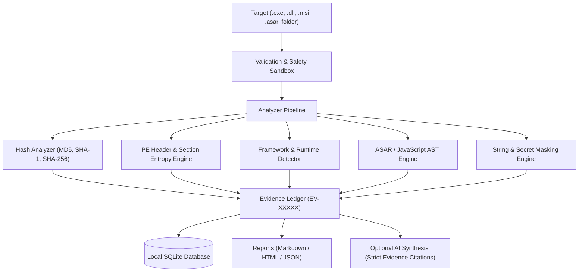

# AS Inspect

<p align="center">
  <strong>Understand applications with evidence.</strong>
</p>

<p align="center">
  <a href="https://github.com/abusafyan-official/AS-Inspect/actions"></a>
  <a href="https://github.com/abusafyan-official/AS-Inspect/releases"></a>
  <a href="LICENSE"></a>
  <a href="#"></a>
  <a href="#"></a>
</p>

<p align="center">
  <em>Evidence-based Windows binary and application inspection toolkit with native parsers and optional AI analysis.</em><br>
  <strong>Developed by Abu Safyan</strong>
</p>

---

## ⚡ Overview

**AS Inspect** is a specialized reverse-engineering and application auditing toolkit built for developers, security researchers, and systems engineers. It inspects software that you own or are authorized to inspect without executing untrusted binaries.

Inspired by modern reverse-engineering workflows and MCP tooling (such as `morluto/rea`), AS Inspect strictly enforces the **Evidence-First Principle**:

$$\text{Observed Fact} \neq \text{Inference} \neq \text{AI Hallucination}$$

Every single finding carries a distinct **Evidence ID** (`EV-000123`), source pointer, and confidence level.

---

## 🎯 Key Capabilities

- 🔍 **Native Windows PE Inspection:** Inspects x86, x64, ARM, and ARM64 executables (`.exe`, `.dll`, `.sys`). Extracts entry points, image bases, section tables, Shannon entropy (to identify compressed/packed sections), and version tables.
- 🧱 **Framework Identification:** Evidence-based detection for **Electron**, **.NET (Framework/CLR & .NET Core)**, **Python (PyInstaller/frozen)**, **Qt**, and **Java/JVM**.
- 📦 **Electron & ASAR Archive Extraction:** Safe parsing of `.asar` headers, directory trees, file sizes, and extension distributions without unbundling or running untrusted scripts.
- 📜 **Safe String & Secret Masking:** Scans ASCII and UTF-16 strings with automatic redaction of high-entropy API tokens and private keys (`sk-**************`, `AIza**************`).
- 🌐 **URL & Network Surface Mapping:** Discovers static URLs, domains, and registry keys referenced inside binary sections without executing active network requests.
- 🗃️ **Embedded Evidence Database:** Automatically persists targets, hashes, and evidence ledgers into a structured SQLite database.
- 🤖 **AI Explanation Layer:** Connect any OpenAI-compatible or local LLM to explain findings—the AI answers cite only verifiable Evidence IDs.
- 🔌 **Model Context Protocol (MCP) Server:** Expose inspection tools directly to AI coding agents (Claude Desktop, Cursor, Antigravity) safely over stdio.

---

## 📊 Pipeline Architecture



---

## 🚀 Quick Start

### 1. Installation

Clone and install dependencies:

```powershell
git clone https://github.com/abusafyan-official/AS-Inspect.git
cd AS-Inspect
python -m pip install -r requirements.txt
```

### 2. Command Line Interface (CLI)

#### Full Technical Analysis with Markdown Export
```powershell
python apps/cli/as_inspect_cli.py analyze C:\Windows\System32\notepad.exe --markdown notepad_report.md
```

#### Calculate Cryptographic Hashes
```powershell
python apps/cli/as_inspect_cli.py hash target.exe
```

#### Inspect DLL Dependencies & Imports
```powershell
python apps/cli/as_inspect_cli.py imports target.dll
```

#### Detect Framework & Runtime Indicators
```powershell
python apps/cli/as_inspect_cli.py detect app.exe
```

---

## 🧪 Verified Test Suite

AS Inspect includes rigorous automated unit and integration tests:

```powershell
python -m pytest tests/
```

```text
tests/test_analyzers.py ....                                             [ 57%]
tests/test_pe_and_edgecases.py ...                                       [100%]

============================== 7 passed in 0.24s ==============================
```

Tests cover:
- Cryptographic hash verification (MD5, SHA-1, SHA-256)
- Secret masking & API key redaction
- JavaScript static import & URL discovery
- SQLite persistence & schema integrity
- Real Windows x64 binary execution (`python.exe`)
- Malformed & truncated PE file fault tolerance (safe failure without crash)
- 0-byte empty file edge case handling

---

## 🛡️ Security & Responsible Inspection

- **Non-Execution Guarantee:** AS Inspect is a static analysis engine. It never executes `.exe`, `.dll`, `.bat`, or `.js` payloads.
- **Safety:** Discovered URLs and domains are strictly cataloged; AS Inspect does not perform outbound HTTP network requests against discovered endpoints.
- **Privacy:** Credentials and sensitive tokens are masked on extraction.

---

## 📄 License

Distributed under the MIT License. See `LICENSE` for more information.

---

<p align="center">
  <strong>AS Inspect</strong> — Understand applications with evidence.<br>
  Built with ❤️ by <strong>Abu Safyan</strong>
</p>
